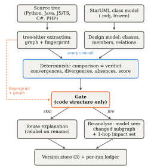
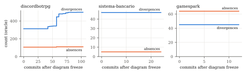
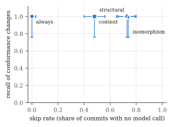

# Measuring Conformance Drift Against Abandoned UML Designs: Continuous Checking Without Paying a Language Model Every Commit

*Formal version of the paper. IEEE two-column format (target: MSR, ICSME, SANER
or ICSA; 10 pages plus references). Every number in this paper was produced by
the scripts in the replication package on 5 October 2026; Section V-G gives the
commands.*

**Sarvesh Sakthivel** (sarveshs2025@gmail.com)

---

## Abstract

A UML class diagram records an intended design, and the code it describes
starts to move away from it as soon as the diagram is committed. Conformance
checking measures that distance at a single point in time. Drift, however, is a
property of a history, so measuring it means re-checking conformance at every
commit. Language models make such a check easier to build and its findings
easier to read, but they put a token price on every re-check, even though most
commits cannot change whether code matches a class diagram.

We present CompX, a conformance checker for StarUML class models and Python,
Java, JavaScript, TypeScript, C# and PHP code. Its design rule is that the
conformance verdict is computed deterministically on every commit and only the
model-authored explanation is gated. A structural gate, which never reads the
diagram, uses the code's own structure to decide whether the explanation must
be regenerated. We define drift measures over the deterministic findings
(trajectory, direction, and element-level survival) and compare four gate
policies.

We evaluate on 16 seeded deviations with declared outcomes and on the full
first-parent histories of three open-source projects whose authors committed a
StarUML model and then stopped maintaining it (142 commits; JavaScript, Java,
C#; 845–1,777 days of drift). On the seeded set, the structural gate caught all
10 conformance-changing deviations and wasted one call. The isomorphism gate
wasted none and missed only the consistent class rename it is designed to
absorb. On the corpus, 12 of 139 commit transitions changed conformance. Every
gate re-analysed all 12, and the structural gate skipped 73% of commits and cut
counterfactual prompt tokens by 93%. Drift was concentrated and went in one
direction. In the one project that drifted, divergences grew by 185 and
absences by 4 over 11 eroding commits and no repairing ones, and 95% of the new
divergences arrived in six merge commits. We also report two methodological
findings. Replaying non-merge commits in date order fabricated 22 of 95 apparent
conformance changes by interleaving branches, and four defects in the measuring
instrument came to light only through labelled cases and an interface
cross-check. The tool, the deviation set, the corpus and the scripts behind
every number are released.

**Index Terms —** architectural drift, architecture conformance checking,
reflexion models, UML, large language models, incremental analysis, mining
software repositories.

---

## I. Introduction

The gap between a system's intended design and its implementation opens
gradually and is expensive to close. Perry and Wolf named the phenomenon [1],
and surveys document three decades of attempts to control it [2], [3]. Several
established techniques detect it: reflexion models [4], [5],
dependency-structure matrices [6] and dependency-constraint languages [7], which
Passos et al. [8] and Knodel and Popescu [9] compare side by side. Case studies
show that drift is real and costly in commercial development [10], and
practitioners value conformance checking but rarely keep it up [11].

**Drift needs a history.** The techniques above answer one question at one
point in time: does this code conform to this design? Drift is the change in
that answer, so observing it requires repeating the check commit by commit.
Evolution studies instead compare architectures at selected releases [12],
[13]. Where design documents have been tracked over commits, the quantity
measured has been how much of the code the diagram covers, not reflexion-style
conformance [14].

**Cost of language models.** A model can relate a class diagram to code without
a hand-maintained mapping and explain each finding in prose, which addresses the
maintenance burden behind abandoned conformance tools [11]. It also turns a
check that cost almost nothing into one priced per token, and a check that runs
at every commit multiplies that price by the length of the history. Most
commits cannot change conformance to a class diagram at all: a reformatted
file, a new comment or a renamed local variable leaves it as it was. A 2025
systematic review of language models in software architecture examined 18
studies and reports: *"We found no articles regarding evaluating quality aspects
of software architecture, such as evolvability, and architecture conformance
checking"* [15].

**Source of the design.** A diagram recovered from the code under study conforms
by construction, so it measures nothing. Abandoned diagrams avoid that
circularity, and they are common. Romeo et al. deep-cloned 13,152 GitHub
repositories, found UML in 552 (4.2%), and found that fewer than one third of
the projects containing UML had any UML-file activity in 2022 [16]. An abandoned
diagram states a real intended design that nobody built for a study, so the
drift away from it is real as well.

We ask four research questions:

* **RQ1:** How does real code drift from an abandoned class model?
* **RQ2:** How much model invocation does each gate avoid?
* **RQ3:** What does skipping cost?
* **RQ4:** Can the measuring instrument be trusted?

**Contributions.**

1. A design rule for LLM-assisted conformance checking, *gate the explanation,
   never the verdict*. Under this rule a wrong gate decision can leave an
   explanation stale but cannot change the score or the lists of divergences
   and absences (Section III-A).
2. Drift measures computed from deterministic reflexion findings alone:
   trajectory, direction (divergence-led or absence-led), and element survival
   with Kaplan–Meier censoring (Section III-E).
3. Four structural gate policies behind one switch, and a replay method that
   counts a miss as *staleness of the served analysis* against a forced oracle
   at every commit (Sections III-D and IV-B).
4. A study on 16 labelled deviations and the complete first-parent histories of
   three projects with author-abandoned StarUML models, including a sensitivity
   analysis on 678 non-merge commits (Section V).
5. Two methodological findings that apply to other drift studies: non-merge
   replay fabricates drift by interleaving branches, and four instrument
   defects were found only through labelled cases and an interface cross-check
   (Sections V-E and V-F).
6. A replication package with the tool, deviations, frozen models, raw runs and
   the scripts behind every table and figure.

---

## II. Background and Related Work

**Conformance checking.** We take our vocabulary from reflexion models [4], [5].
A *convergence* is present in both the design and the code, a *divergence* in
the code but not the design, and an *absence* in the design but not the code.
ReflexML [17] applies reflexion models with UML as the high-level model and is
the classical work closest to our input. Passos et al. [8] and Knodel and
Popescu [9] compare the main families; DSMs [6] and DCL [7] replace the explicit
model with dependency rules. All of them need the intended architecture in a
tool-specific formalism plus a mapping from source to model. We reduce the
mapping to name correspondence, which is how class diagrams are ordinarily read
(Section VII).

**Drift and erosion.** De Silva and Balasubramaniam conclude that detection
remains the practical bottleneck [2]. Architecture-evolution studies compare
recovered architectures across releases [12], [13]. Li et al. detect erosion
symptoms in code review [18], and Tekinerdogan builds drift analysis on
reflexion viewpoints [19]. The work closest to ours is by Romeo et al. [14], who
capture drift between design, implementation and documentation by linking
PlantUML diagrams to Java classes and tracking UML *coverage* across releases
and commits. We measure reflexion-style *conformance* against a frozen StarUML
model at every first-parent commit, separate its two directions, and analyse
element survival with censoring.

**Incremental analysis.** Egyed's instant consistency checking [20], [21]
re-evaluates only the UML consistency rules that a model change can affect, and
IncA [22] does the same for program analyses. Our gate shares the idea but has a
different cost model. Those approaches save CPU time on cheap deterministic
checks, where an over-approximate scope costs almost nothing. We save money on
an expensive, non-deterministic step, so a skip needs a stated failure mode and
a measured miss rate.

**Language models and cost.** The 2025 review [15] reports no LLM-based
conformance work and notes that about one third of the studies it covers lack a
baseline; our deterministic mode provides one by construction. Hybrid designs
ground a model in a static analyser [23]. Cost control through cascades and
response caching [24], or through semantic caches keyed on prompt similarity
[25], decides from the prompt. Our gate decides from a verified structural
property of the artefact. We follow the reporting guidelines of Baltes et al.
[26].

---

## III. Approach

### A. Gate the explanation, never the verdict

Fig. 1 shows one analysis. Source code is parsed with tree-sitter into an
implementation graph, the StarUML model is parsed into a design model, and a
deterministic engine computes reflexion findings. These steps run on every
commit, whatever the gate decides. The gate decides only whether the
model-authored analysis (gaps and recommendations in prose) is regenerated for
the changed subgraph or reused from the previous version.


*Fig. 1. One analysis. The verdict is computed on every commit and only the
explanation is gated. The gate's only input is code structure (dashed). The
solid arrow into the gate shows order, not data flow; the gate never reads the
diagram.*

Because the verdict is recomputed every time, a wrongly skipped commit leaves an
out-of-date explanation next to a score and lists of divergences and absences
that are current. Section VI-A argues that any tool that puts a language model
into a conformance loop should have this property.

### B. Extraction

The extractor handles six languages. It collects classes, interfaces, methods,
fields (declared, or assigned through `self.`/`this.` in languages without
declarations), supertypes together with the clause that declared them, imports
and call sites. Calls are resolved through a project-wide symbol table. A call
with several plausible targets is counted as ambiguous instead of being linked
to all of them, and the resolution rate is reported with every run.

### C. Deterministic comparison

Design and implementation are compared by element name. Each designed class,
each designed attribute and operation of a present class, and each designed
generalization and realization is a check, and the score is the share of checks
passed. Associations cannot be proven from code (a typed field is strong
evidence, a matching name only weak evidence), so they are graded and left out
of the score. Three conventions affect the counts:

* **Supertype kind.** Where the language states whether a supertype is extended
  or implemented (Java, TypeScript, PHP), the kind must match the diagram.
  Where it does not (Python, JavaScript, and C# bases outside the project), the
  declared supertype satisfies either UML relation.
* **Constructors.** An undocumented constructor is not a divergence, but a
  constructor that the diagram specifies is still checked.
* **Counting.** Convergences are passed checks plus satisfied relations.
  Divergences are undocumented classes plus undocumented members of designed
  classes. Absences are missing classes, missing members and unsatisfied scored
  relations.

### D. Gates

Each gate is defined by the property it tests, and that property fixes both
what the gate absorbs and what it can miss (Table I). No gate reads the diagram.

**Table I. Gate policies.**

| Gate | Re-analyses when | Absorbs | Designed-in risk |
|---|---|---|---|
| `always` | every commit | nothing | none (baseline) |
| `content` | analysed bytes change | nothing structural | pays for comments, formatting |
| `structural` | the AST fingerprint changes | formatting, comments, literals, local names, statement order | a semantic change with identical structure |
| `isomorphism` | fingerprint changes **and** the graph is not isomorphic to the previous one | also pure renames and reorderings | a consistent rename of a class the diagram names |

The fingerprint covers declarations, types, supertypes, imports and the *set* of
callee names of each callable. It leaves out receivers, local names, statement
order, comments, formatting and literals. The callee set has to be included,
because without it the gate would not notice a controller that starts calling
the persistence layer directly. The isomorphism gate runs VF2 [27] with
kind-preserving node matchers and relation-preserving edge matchers. When an
isomorphism exists, the mapping is the renaming, so the cached explanation is
relabelled. The gate's failure mode is part of its specification. A consistent
rename preserves shape, so the gate reuses the explanation, yet conformance has
changed if the diagram names the renamed class. When a gate fires, the model
receives only the changed subgraph and its 1-hop impact set, together with the
deterministic findings as facts it must not contradict. The cost of a
re-analysis therefore grows with the size of the change, not the size of the
project.

### E. Drift measures

All measures are computed from the oracle's findings at each commit, and no
gate affects them.

1. **Trajectory.** Convergences, divergences and absences at every commit after
   the freeze.
2. **Direction.** Net change in divergences and absences. A window is
   *divergence-led* when divergences grew at least as much as absences, meaning
   the code grew away from the design. It is *absence-led* when designed
   structure disappeared faster. We also count *eroding* commits (total
   deviations rose) and *repairing* commits (total deviations fell).
3. **Element survival.** At each commit, each designed element is *conforming*,
   *divergent* (all designed members present plus undocumented ones),
   *partial* (a designed member missing) or *absent*. For elements conforming at
   the freeze, time to first deviation is right-censored at the end of the
   window and estimated with Kaplan–Meier [28]. The half-life is the first
   commit at which survival reaches 0.5, and is reported as "not reached"
   otherwise. Elements that were already deviating at the freeze are reported
   separately instead of being assigned time zero.

---

## IV. Study Design

### A. Subjects

**Controlled set.** The controlled set is a four-layer Python reference project
(controller, service, domain, persistence) that matches its StarUML model
exactly, together with 16 reproducible mutations. Each mutation declares whether
it should change structure and whether it should change the deterministic
findings. Nine are conformance-breaking: a deleted designed method, a deleted
designed class, an undocumented class, a removed realization, an untyped
association, a controller bypassing the service, an inverted dependency, and
partial and consistent class renames. Two change structure only: an
undocumented private helper, which is a divergence, and an added optional
parameter, which name-based comparison does not see. Five are negative controls
(comment, whitespace, local rename, method reorder, docstring). Ten of the
sixteen should change the findings.

**Corpus.** We looked for repositories in which the project's own authors
committed a StarUML `.mdj` *class* model and then stopped editing it while
development continued. For each model we counted the source-touching commits
after its last edit. Three projects qualified (Table II), and all three designs
are *found*, not recovered. The candidates we examined and rejected are listed
with reasons in the tool's repository. The usual reasons were models with no
class elements (use-case or sequence diagrams only), models maintained alongside
the code (no drift window), and models with no paired source.

**Table II. Corpus. Figures at the freeze commit.**

| Project | Lang. | Model last edited | Code until | Days | Commits | Files | LOC | Classes / relations in model | Score at freeze |
|---|---|---|---|---|---|---|---|---|---|
| DiscordBotRPG-Server | JS | 2019-12-01 `f2ab878` | 2023-01-27 | 1,153 | 104 | 91 | 13,221 | 22 / 69 | 33.33% (29/87) |
| sistema-bancario-java-junit | Java | 2020-08-13 `16508fe` | 2025-06-26 | 1,777 | 25 | 8 | 659 | 8 / 9 | 90.00% (36/40) |
| GameSpark | C# | 2022-02-25 `8902f40` | 2024-06-19 | 845 | 13 | 52 | 3,629 | 53 / 88 | 91.72% (432/471) |

*Commits: the freeze commit plus every first-parent commit after it. Files and
LOC: the analysed source directory (`bin/`, `src/main/java/`, `Assets/…/Script/`).*

The DiscordBotRPG model as committed was not valid JSON, because four string
literals lacked a closing quote. We added exactly those four characters and
checked with a line diff that nothing else differs. The other two models are
semantically identical to the repository originals.

### B. Procedure

Each project is replayed from the freeze commit along the **first-parent
mainline**, merges included, so every step is a real change from parent to
child (Section V-E explains why this matters). At every commit the source is
materialised and analysed once by a forced full analysis, the **oracle**, and
once by each gate. Each gate runs in its own project directory so that no gate
benefits from another's cache. A commit **changed conformance** when the
oracle's findings differ from the oracle's findings at the previous commit, and
**touched source** when any analysed file changed.

**What counts as a miss.** The deterministic findings are recomputed on every
run, so a gated run's findings always equal the oracle's. Comparing those two,
as an earlier version of our harness did, can only ever report zero misses. What
a gate can leave stale is the explanation it *serves*. Each gate therefore
records the findings its current explanation was produced from, and a run is
**missed** when the gate reused its explanation and those findings differ from
the oracle's. We report *recall* (the share of conformance-changing commits
that were re-analysed), *specificity* (the share of the other commits that were
skipped), stale runs as a share of all runs, and a recovery horizon. The
recovery horizon is the number of commits from the start of a stale stretch
until it is refreshed, estimated with Kaplan–Meier with censoring.

**Cost.** All runs used the deterministic offline mode, so no model was called
and the study can be reproduced exactly. For each run in which a gate would have
called a model, we record the size of the prompt it would have sent, in
`cl100k_base` tokens; the value is zero when the gate reused. These
*counterfactual prompt tokens* are an estimate of cost and are never presented
as measured spend.

### C. Statistics

Proportions carry 95% Wilson intervals [29]. The two candidate gates are
compared with McNemar's exact test [30] on discordant commits. The test is
suppressed when there are fewer than six discordant pairs, because then no
outcome could reach p < 0.05. Survival is estimated with Kaplan–Meier [28]. A
rate whose denominator is empty is reported as *not measured*, never as zero.

---

## V. Results

### A. RQ1: How the code drifted

**Table III. Drift over the post-freeze window (oracle findings, first-parent).**

| Project | Transitions | Touched source | Changed conformance | Divergences | Absences | Eroding / repairing | Direction | Score |
|---|---|---|---|---|---|---|---|---|
| DiscordBotRPG | 103 | 62 | 12 | 313 → 498 | 106 → 110 | 11 / 0 | divergence-led | 33.33% → 34.04% |
| sistema-bancario | 24 | 8 | 0 | 47 → 47 | 5 → 5 | 0 / 0 | stable | 90.00% → 90.00% |
| GameSpark | 12 | 1 | 0 | 45 → 45 | 64 → 64 | 0 / 0 | stable | 91.72% → 91.72% |
| **Pooled** | **139** | **71** | **12 (8.6%, CI 5.0–14.5%)** | | | | | |


*Fig. 2. Divergences and absences at every first-parent commit after the
diagram freeze.*

**Overall pattern.** Only 12 of 139 commit transitions changed conformance, all
of them in DiscordBotRPG, and even there 51 of the 62 source-touching commits
left conformance unchanged. In the two smaller projects, the nine
source-touching commits after the freeze changed nothing a class diagram
describes. DiscordBotRPG's drift was divergence-led: the code grew away from its
design, with 185 new divergences against 4 new absences. Eroding commits
outnumbered repairing commits 11 to 0, so the drift never reversed. The first
conformance change came at mainline commit 38 (April 2020), four months after
the freeze.

**Sources of divergence.** Between the freeze and the last commit, undocumented
classes grew from 80 to 131 (+51) and undocumented members of designed classes
from 233 to 367 (+134). Together these account for exactly the 185 new
divergences. Missing designed members rose from 33 to 38, and missing designed
classes fell from 13 to 12 because `Monster` reappeared. Most of the divergence
arrived with releases. Six merge commits of release branches carried 175 of the
185 new divergences (95%). One merge alone (pull request #30, release 1.10,
January 2021) carried 103 (56%), and the three largest carried 160 (86%).

**Element survival.** Table IV shows why the survival analysis says little about
this corpus. In DiscordBotRPG, none of the 22 designed elements conformed at the
freeze: 13 were already absent, 7 partial and 2 divergent. The design had
drifted before its authors stopped editing the diagram, and the new drift in the
window took the form of undocumented code added around the designed elements.
In the two smaller projects, 33 elements conformed at the freeze and none
deviated within their windows, so survival stayed at 1.0 and the half-life was
not reached (it exceeds 24 and 12 commits respectively).

**Table IV. Designed-element status at the freeze and at the end of the window.**

| Project | Designed | Conforming | Divergent | Partial | Absent | Changed status |
|---|---|---|---|---|---|---|
| DiscordBotRPG | 22 | 0 → 0 | 2 → 2 | 7 → 8 | 13 → 12 | `Monster`: absent → partial |
| sistema-bancario | 8 | 1 → 1 | 4 → 4 | 1 → 1 | 2 → 2 | none |
| GameSpark | 53 | 32 → 32 | 5 → 5 | 16 → 16 | 0 → 0 | none |

*Answer to RQ1.* In the one project that drifted, most of the design was already
gone when the diagram was abandoned. Later drift was divergence-led, monotone
and delivered by release merges. In the other two projects, the abandoned
diagrams stayed exactly as accurate as when they were last edited.

### B. RQ2: What each gate avoids

**Table V. Gates over the corpus (142 commits, 139 judged transitions).**

| Gate | Re-analysed | Skip rate [95% CI] | Recall (n = 12) | Specificity (n = 127) | Counterfactual tokens | Saved |
|---|---|---|---|---|---|---|
| always | 142 | 0.0% [0–3] | 100% [76–100] | 0.0% [0–3] | 19,770,303 | — |
| content | 74 | 48% [40–56] | 100% [76–100] | 54% [45–62] | 6,872,366 | 65% |
| structural | 39 | 73% [65–79] | 100% [76–100] | 81% [73–87] | 1,392,753 | 93% |
| isomorphism | 37 | 74% [66–80] | 100% [76–100] | 83% [75–88] | 1,386,369 | 93% |


*Fig. 3. Skip rate against recall of conformance changes, 95% Wilson intervals.*

The two structural gates skipped about three commits in four. Their token saving
(93%) is larger than their skip rate because of scoping. Under the structural
gate, a re-analysis prompt averaged 35,712 tokens (median 16,101), compared with
139,227 (median 146,320) for a full-project prompt under `always`. The content
gate skipped fewer than half the commits. In DiscordBotRPG it skipped only the
41 of 103 transitions that touched no analysed file, and its re-analyses
averaged 92,870 tokens. In 35 of its 71 re-analyses after each project's first
commit, the bytes had changed but the structure had not. The delta was then
empty, there was no impact set to scope the prompt to, and the whole project was
sent.

Per project, the structural gate skipped 67% of DiscordBotRPG's commits, 88% of
sistema-bancario's and 85% of GameSpark's, saving 93.0%, 93.6% and 90.6% of
counterfactual tokens respectively. A single full-project prompt for
DiscordBotRPG was 140,452 tokens at the freeze and 225,324 at the end of its
history, more than the 128k-token context of many deployable models.

*Answer to RQ2.* Gating on structure avoided three quarters of model
invocations and, combined with scoping, more than 90% of prompt tokens.

### C. RQ3: What skipping costs

**Corpus.** No gate served a stale explanation at any commit. Every gate
re-analysed all 12 conformance-changing commits (recall 12/12, 95% CI 76–100%),
so the recovery horizon is not measured: there was nothing to recover from. The
structural and isomorphism gates disagreed on only two commits, both in
sistema-bancario, where the isomorphism gate absorbed a change that altered no
finding. With two discordant pairs, McNemar's test is not computed (it needs at
least six). The structural gate's safety cost 24 re-analyses of commits whose
findings did not change (specificity 81%), while the content gate paid for 59
(specificity 54%).

**Controlled set.** Table VI is the only result with unambiguous ground truth.

**Table VI. Seeded deviations (16 mutations; 10 change the findings).**

| Gate | TP | FN | FP | TN | Precision | Recall |
|---|---|---|---|---|---|---|
| always | 10 | 0 | 6 | 0 | 0.63 | 1.00 |
| content | 10 | 0 | 6 | 0 | 0.63 | 1.00 |
| structural | 10 | 0 | 1 | 5 | 0.91 | 1.00 |
| isomorphism | 9 | 1 | 0 | 6 | 1.00 | 0.90 |

The structural gate's single false positive is the added optional parameter.
The fingerprint sees the change in arity, but name-based comparison does not use
it, and the isomorphism gate absorbs this case. The isomorphism gate's single
miss is the consistent rename of `OrderRepository` described in Section III-D,
so the only failure observed is the one designed in. Both structural gates
skipped all five negative controls, and both baselines paid for all five.

*Answer to RQ3.* On the corpus, skipping cost nothing. On the labelled set, the
only cost was the specified rename case, and under our design that case could
make only the explanation stale, never the verdict.

### D. RQ4: Can the instrument be trusted?

*Labels.* For all 16 mutations, whether the oracle's findings changed matches
the declared label.

*Oracle determinism.* Each project's replay ran as four independent processes,
one per gate, each with its own oracle. Before merging the results, we compared
the four oracle copies at every commit on conformance change, source change,
reflexion counts, score and findings hash. They agreed at all 142 commits, and
at all 716 commits of the non-merge sensitivity replay.

*Interface agreement.* We used browser automation to drive the tool's web
interface. We created projects from the freeze-commit source of
sistema-bancario and DiscordBotRPG, uploaded the frozen models and ran a check.
The interface reported 90% (36 of 40 checks) and 33.33% (29 of 87), the same
values as the research pipeline. A further check of the unchanged DiscordBotRPG
project was skipped by the structural gate ("fingerprint unchanged") and still
reported the current 33.33%, which is the property of Section III-A observed in
the running product.

### E. Sensitivity: replaying non-merge commits instead

A common alternative is to replay every non-merge commit after the freeze in
date order. For DiscordBotRPG this gives 678 commits. The endpoints are
identical (divergences 313 → 498, absences 106 → 110), but the trajectory is
not. The replay shows 95 apparent conformance changes, 77 eroding commits and 15
"repairing" ones. Of its 677 transitions, 64 join commits that are not parent
and child. These are consecutive commits from parallel branches, one of which
still named a class `Monstre` while the other had renamed it `Monster`, and they
carried 22 of the 95 apparent changes. The gate results stay qualitatively the
same (recall 95/95 for every gate, structural skip rate 53%, counterfactual
saving 94%). The cost conclusions are therefore robust to the history model,
but the drift conclusions are not.

### F. Defects found in the instrument

We report these because each one would have biased a headline number, and
none was caught by tests that only checked that the pipeline ran. Items 1 to 4
are defects in the instrument; item 5 is a flaw in the replay method.

1. **Supertype order.** Supertype names were sorted for the fingerprint, and
   the comparator then took the first one as the superclass. As a result,
   `class A extends Zeta implements Alpha` became `extends Alpha`, and a Python
   realization could never be satisfied. The seeded *remove-realization*
   deviation was invisible, and sistema-bancario scored 80% instead of 90%
   because four `implements Cadastro` realizations were scored as
   generalizations.
2. **JavaScript fields.** Fields assigned as `this.x = …` were not extracted,
   so every designed attribute of a JavaScript class appeared absent.
   DiscordBotRPG scored 19.54% instead of 33.33% at its freeze.
3. **Oracle blind to member divergence.** The oracle left out undocumented
   members, so it could not see the seeded *add-private-helper* divergence.
4. **Misses that could not occur.** The replay compared freshly computed
   findings with the oracle's, which are equal by construction, so the corpus
   miss rate was zero whatever a gate did.
5. **Branch interleaving** (Section V-E). The commit ordering produced 23% of
   the apparent conformance changes.

Each of these is fixed and covered by a regression test (279 tests in total).

### G. Reproducing the results

```
python research/evaluate_deviations.py --out results/                       # Table VI
python research/replay.py --corpus research/corpus.json --out results/      # raw runs
python research/analyze_statistics.py --runs results/runs.csv --out results/ --replication
python research/make_figures.py --results results/ --out paper/figures/     # Figs. 2-3
python research/paper_numbers.py --results results/                         # Tables III-V
```

---

## VI. Discussion

### A. Gate the explanation, never the verdict

LLM cost control is usually framed as a trade-off between saving money and
staying correct. That framing fits the explanation but not the verdict. The
deterministic comparison is cheap: a full analysis of DiscordBotRPG, which grew
from 13,221 to 21,975 lines over its window, took a median of 470 ms (maximum
720 ms). It never needs gating, so the gate decides only whether to pay for new
prose. The worst a gate can then do is leave a developer reading an explanation
written for an earlier state, *next to a score and lists of findings that are
current.* A tool that lets a cost optimisation change its verdict makes the
correctness of that verdict depend on a heuristic. We think the separation
should be a requirement.

The separation also answers an obvious question: why not re-invoke the model
exactly when the deterministic findings change? That policy costs nothing to
run and has perfect recall *against this oracle*, which is exactly why this
oracle cannot evaluate it: the policy and the ground truth would be the same
function. It would also ignore changes that structural gates notice and the
findings do not, such as a new call edge between two designed classes. Such an
edge changes no reflexion count but may be exactly what a reviewer wants
explained. Evaluating that trade-off requires judging the explanations
themselves.

### B. Choosing a gate

A gate is safe exactly when the property it tests implies the property one
cares about. The content gate is trivially safe but wasteful on real histories:
it re-analysed 59 commits that changed nothing a diagram describes. The
structural gate missed nothing in either evaluation and cost 24 unnecessary
re-analyses over 139 transitions. The isomorphism gate saved little extra in
practice (two commits), and its only miss was the specified rename. We
recommend the structural gate for teams whose diagrams name concrete classes.
Teams whose diagrams describe roles can take the isomorphism gate's small
additional saving.

### C. What the drift says about abandoned diagrams

Two of the three abandoned diagrams were as accurate at the end of their
windows as when they were last edited: development continued for 845 and 1,777
days without touching anything they describe. The third had already lost most
of its design when it was abandoned, with 13 of its 22 designed classes absent
at the freeze. After that, the code grew *around* the remaining design instead
of eroding it further, adding 51 undocumented classes and 134 undocumented
members, with 4 new absences and no repairs. Because this growth arrived in
release merges, it suggests a practical schedule. A conformance check gated on
structure is cheap enough to run on every commit, but the drift that deserves a
human's attention is concentrated where release branches land.

### D. Methodological lessons

Replaying a repository's non-merge commits in date order is a convenient
default, but for drift it is the wrong one. Consecutive commits can come from
different branches, so the replay observes changes that nobody made. Here it
fabricated about a quarter of the apparent drift events and every "repair",
while leaving the cost results almost unchanged. Drift studies should replay
the first-parent history, or the full DAG with each commit compared to its own
parent. Instruments for drift studies also need labelled cases: two of the
defects in Section V-F would have produced plausible but wrong numbers while
every unlabelled test passed.

---

## VII. Threats to Validity

**Construct.** Conformance is name-based. A rename in the code but not in the
diagram counts as an absence plus a divergence. This is the reflexion reading,
but it may overstate drift for a pure rename. Associations are graded rather
than scored, and constructors are excluded from divergences by convention;
either choice changes the counts. Call resolution was 25–37% at the freeze
commits, with no ambiguous call sites. Most unresolved calls target library code
that a class diagram does not describe, but resolution limits how much call
structure the fingerprint reflects. Costs are counterfactual prompt sizes, not
measured spend, and they exclude completion tokens.

**Internal.** The oracle is the same deterministic engine that the gates rely
on, so a conformance change the engine cannot see is also invisible to the
oracle. The labelled set guards only against the deviation kinds it contains.
We found and fixed four instrument defects and one flaw in the replay method
(Section V-F). Others of the same kind may remain, which is why every raw run is
released.

**External.** Three projects make a small corpus, and the one that drifted
dominates every corpus-level rate. Two of the windows are short (13 and 25
commits). The results describe these histories, not open-source software in
general. The selection is itself a filter, since it keeps only projects whose
authors drew a StarUML class diagram and committed it. A diagram may have been
abandoned because the part of the system it described was abandoned, so Table
IV reports elements individually to let readers judge this. No language model
was called, so run-to-run variance of model output [26] is not measured here;
the design confines that variance to the explanation.

**Conclusion.** Every proportion carries a Wilson interval. Recall rests on 12
conformance-changing commits (CI 76–100%), which is enough to say that no gate
failed often, but not that gates never fail. McNemar's test could not be
computed. Pooled rates treat commits as independent, so per-project figures are
reported next to them.

---

## VIII. Conclusion

We set out to measure conformance drift at every commit after a design was
frozen, without paying a language model to re-read an unchanged architecture
each time. Separating the deterministic verdict from the model-authored
explanation made this possible and safe. Drift is measured from a verdict that
is never gated, and the gate controls only what is spent on prose. On three
projects with author-abandoned StarUML models, a structural gate skipped 73% of
commits and cut counterfactual prompt tokens by 93%, while re-analysing all 12
commits that changed conformance. On 16 labelled deviations it caught all 10
that mattered. The drift itself was rare, divergence-led, monotone and delivered
by release merges. Measuring it correctly required replaying the first-parent
history, because date-ordered non-merge replay fabricated about a quarter of
the apparent drift events.

Future work should enlarge the corpus through a systematic search of public
repositories for abandoned class models. It should also evaluate the
explanations themselves, including their stability across runs and what they
add beyond the findings, and test gating policies that combine code structure
with changes in the deterministic findings.

---

## Data Availability

The tool, the seeded deviations, the corpus manifest and frozen models, the raw
per-run data (`runs.csv`, `drift_elements.csv`) and the scripts that produce
every table and figure are available in the replication package
(`<archive link or Zenodo DOI>`).

---

## References

All entries were checked against Crossref, arXiv or the publisher's record on
5 October 2026.

[1] D. E. Perry and A. L. Wolf, "Foundations for the study of software architecture," *ACM SIGSOFT Softw. Eng. Notes*, vol. 17, no. 4, pp. 40–52, 1992, doi: 10.1145/141874.141884.

[2] L. de Silva and D. Balasubramaniam, "Controlling software architecture erosion: A survey," *J. Syst. Softw.*, vol. 85, no. 1, pp. 132–151, 2012, doi: 10.1016/j.jss.2011.07.036.

[3] L. Hochstein and M. Lindvall, "Combating architectural degeneration: A survey," *Inf. Softw. Technol.*, vol. 47, no. 10, pp. 643–656, 2005, doi: 10.1016/j.infsof.2004.11.005.

[4] G. C. Murphy, D. Notkin, and K. Sullivan, "Software reflexion models: Bridging the gap between source and high-level models," in *Proc. 3rd ACM SIGSOFT Symp. Found. Softw. Eng.*, 1995, pp. 18–28, doi: 10.1145/222124.222136.

[5] G. C. Murphy, D. Notkin, and K. J. Sullivan, "Software reflexion models: Bridging the gap between design and implementation," *IEEE Trans. Softw. Eng.*, vol. 27, no. 4, pp. 364–380, 2001, doi: 10.1109/32.917525.

[6] N. Sangal, E. Jordan, V. Sinha, and D. Jackson, "Using dependency models to manage complex software architecture," in *Proc. OOPSLA*, 2005, pp. 167–176, doi: 10.1145/1094811.1094824.

[7] R. Terra and M. T. Valente, "A dependency constraint language to manage object-oriented software architectures," *Softw. Pract. Exper.*, vol. 39, no. 12, pp. 1073–1094, 2009, doi: 10.1002/spe.931.

[8] L. Passos, R. Terra, M. T. Valente, R. Diniz, and N. das Chagas Mendonça, "Static architecture-conformance checking: An illustrative overview," *IEEE Softw.*, vol. 27, no. 5, pp. 82–89, 2010, doi: 10.1109/MS.2009.117.

[9] J. Knodel and D. Popescu, "A comparison of static architecture compliance checking approaches," in *Proc. WICSA*, 2007, doi: 10.1109/WICSA.2007.1.

[10] J. Rosik, A. Le Gear, J. Buckley, M. A. Babar, and D. Connolly, "Assessing architectural drift in commercial software development: A case study," *Softw. Pract. Exper.*, vol. 41, no. 1, pp. 63–86, 2011, doi: 10.1002/spe.999.

[11] N. Ali, S. Baker, R. O'Crowley, S. Herold, and J. Buckley, "Architecture consistency: State of the practice, challenges and requirements," *Empir. Softw. Eng.*, vol. 23, no. 1, pp. 224–258, 2018, doi: 10.1007/s10664-017-9515-3.

[12] D. M. Le, P. Behnamghader, J. Garcia, D. Link, A. Shahbazian, and N. Medvidovic, "An empirical study of architectural change in open-source software systems," in *Proc. MSR*, 2015, pp. 235–245, doi: 10.1109/MSR.2015.29.

[13] P. Behnamghader, D. M. Le, J. Garcia, D. Link, A. Shahbazian, and N. Medvidovic, "A large-scale study of architectural evolution in open-source software systems," *Empir. Softw. Eng.*, vol. 22, no. 3, pp. 1146–1193, 2017, doi: 10.1007/s10664-016-9466-0.

[14] J. Romeo, M. Raglianti, C. Nagy, and M. Lanza, "Capturing and understanding the drift between design, implementation, and documentation," in *Proc. 32nd IEEE/ACM Int. Conf. Program Comprehension (ICPC)*, 2024, pp. 382–386, doi: 10.1145/3643916.3644399.

[15] L. Schmid, T. Hey, M. Armbruster, S. Corallo, D. Fuchß, J. Keim, H. Liu, and A. Koziolek, "Software architecture meets LLMs: A systematic literature review," arXiv:2505.16697, 2025.

[16] J. Romeo, M. Raglianti, C. Nagy, and M. Lanza, "UML is back. Or is it? Investigating the past, present, and future of UML in open source software," in *Proc. 47th IEEE/ACM Int. Conf. Softw. Eng. (ICSE)*, 2025, pp. 2342–2354, doi: 10.1109/ICSE55347.2025.00155.

[17] J. Adersberger and M. Philippsen, "ReflexML: UML-based architecture-to-code traceability and consistency checking," in *Proc. ECSA*, LNCS, 2011, pp. 344–359, doi: 10.1007/978-3-642-23798-0_37.

[18] R. Li, P. Liang, P. Avgeriou, and Y. Wang, "Towards automated identification of violation symptoms of architecture erosion," arXiv:2306.08616, 2023.

[19] B. Tekinerdogan, "Architectural drift analysis using architecture reflexion viewpoint and design structure reflexion matrices," in *Software Quality Assurance*. Morgan Kaufmann, 2016, pp. 221–236, doi: 10.1016/B978-0-12-802301-3.00010-7.

[20] A. Egyed, "Instant consistency checking for the UML," in *Proc. 28th Int. Conf. Softw. Eng. (ICSE)*, 2006, pp. 381–390, doi: 10.1145/1134285.1134339.

[21] A. Egyed, "Automatically detecting and tracking inconsistencies in software design models," *IEEE Trans. Softw. Eng.*, vol. 37, no. 2, pp. 188–204, 2011, doi: 10.1109/TSE.2010.38.

[22] T. Szabó, S. Erdweg, and M. Voelter, "IncA: A DSL for the definition of incremental program analyses," in *Proc. 31st IEEE/ACM Int. Conf. Automated Softw. Eng. (ASE)*, 2016, pp. 320–331, doi: 10.1145/2970276.2970298.

[23] S. Blyth, S. A. Licorish, C. Treude, and M. Wagner, "Static analysis as a feedback loop: Enhancing LLM-generated code beyond correctness," arXiv:2508.14419, 2025.

[24] L. Chen, M. Zaharia, and J. Zou, "FrugalGPT: How to use large language models while reducing cost and improving performance," arXiv:2305.05176, 2023.

[25] X. Liu, B. Atalar, X. Dai, J. Zuo, S. Wang, and J. C. S. Lui, "Semantic caching for low-cost LLM serving: From offline learning to online adaptation," arXiv:2508.07675, 2025.

[26] S. Baltes *et al.*, "Guidelines for empirical studies in software engineering involving large language models," arXiv:2508.15503, 2025.

[27] L. P. Cordella, P. Foggia, C. Sansone, and M. Vento, "A (sub)graph isomorphism algorithm for matching large graphs," *IEEE Trans. Pattern Anal. Mach. Intell.*, vol. 26, no. 10, pp. 1367–1372, 2004, doi: 10.1109/TPAMI.2004.75.

[28] E. L. Kaplan and P. Meier, "Nonparametric estimation from incomplete observations," *J. Amer. Statist. Assoc.*, vol. 53, no. 282, pp. 457–481, 1958, doi: 10.1080/01621459.1958.10501452.

[29] E. B. Wilson, "Probable inference, the law of succession, and statistical inference," *J. Amer. Statist. Assoc.*, vol. 22, no. 158, pp. 209–212, 1927, doi: 10.1080/01621459.1927.10502953.

[30] Q. McNemar, "Note on the sampling error of the difference between correlated proportions or percentages," *Psychometrika*, vol. 12, no. 2, pp. 153–157, 1947, doi: 10.1007/BF02295996.
