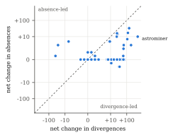
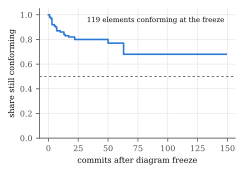
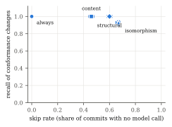

# Measuring Conformance Drift Against Abandoned UML Designs with a Local Language Model in the Loop

**Sarvesh Sakthivel** (sarveshs2025@gmail.com)

---

## Abstract

A UML class diagram is committed, and the code moves on without it. Measuring
that drift means re-checking conformance at every commit. Language models make
the check easier to build and its findings easier to read, but each check
costs a model call, and most commits cannot change whether code matches a
class diagram.

We present CompX, a conformance checker for StarUML class models and code in
six languages, built on one rule: the conformance verdict is computed
deterministically on every commit, and only the model-written explanation is
gated. A gate that never reads the diagram decides from the code's structure
whether the explanation must be regenerated. We compare four gate policies,
with a 7.6-billion-parameter open-weight code model served locally (no hosted
API), and measure drift over 52 open-source projects whose own
authors committed a StarUML class model and then stopped updating it, found by
a systematic search of GitHub and screened by a rule fixed in advance
(2,606 first-parent commits in Java, C#, Python, PHP, JavaScript and
TypeScript).

Drift was common: 44 of 52 projects changed conformance after
their diagram was abandoned, 20.1% of commits changed it, and the drift
was overwhelmingly divergence-led (divergences +1,703, absences
+139). A structural gate re-analysed every one of the 514
conformance-changing commits while skipping 60% of commits and
92% of prompt tokens. With the real model, its seeded-deviation
calls used 35% of the baseline's measured prompt tokens, and the model
evaluated 1.051 times the counterfactual token estimate used in earlier
work (range 1.021–1.092), so that estimate holds up. A graph-isomorphism gate skipped more commits but served stale
explanations after 51 shape-preserving changes, most of them member
replacements rather than the class renames it was designed to tolerate. On a
laptop, only 38% of full-project prompts fit a 32k-token window
against 87% of structurally scoped ones, so scoping is what makes a
local model usable, although the 7.6B model often failed to finish its answer
on real projects; scoping also changes what the model notices. We
release the tool, the corpus search, the live-model protocol and the scripts
behind every number.

**Index Terms —** architectural drift, architecture conformance checking,
reflexion models, UML, large language models, local models, incremental
analysis, mining software repositories.

---

## I. Introduction

The gap between a system's intended design and its code opens slowly and costs
a lot to close. Perry and Wolf gave the problem a name [1], and surveys cover
three decades of attempts to control it [2], [3]. Reflexion models [4], [5],
dependency-structure matrices [6] and dependency-constraint languages [7] can
all detect it, and Passos et al. [8] and Knodel and Popescu [9] compare them.
Drift is real and expensive in commercial development [10], and practitioners
say they value conformance checking yet seldom keep doing it [11].

**Drift needs a history.** Each of these techniques answers one question at one
moment: does this code conform to this design? Drift is how that answer
changes, and seeing it means repeating the check commit after commit. Evolution
studies usually compare architectures at a handful of releases [12], [13].
Where design documents have been followed commit by commit, researchers measured
how much of the code the diagram covers, not whether the code conforms to it in
the reflexion sense [14].

**What language models cost.** A model can relate a class diagram to code
without a hand-maintained mapping and explain each finding in prose. That eases
the maintenance burden that made earlier conformance tools fall out of use [11],
but it puts a price on every check, and running the check on every commit
multiplies the price by the length of the history. Most commits cannot change
conformance to a class diagram anyway: a reformatted file or a renamed local
variable leaves it as it was. A 2025 systematic review of language models in
software architecture found no study of architecture conformance checking [15].

**Where the design comes from.** A diagram recovered from the code under study
conforms by construction and measures nothing. Abandoned diagrams avoid that:
Romeo et al. found UML in 4.2% of 13,152 deep-cloned GitHub repositories, and
fewer than a third of those touched a UML file in 2022 [16]. An abandoned
diagram is a statement of intended design that nobody drew for a study, so the
drift away from it is real.

**This study.** A cost argument about language models is only as good as the
model behind it, and a drift argument only as good as its corpus. A pilot of
this work on three hand-picked projects estimated cost from the size of
prompts it never sent, and only one of its projects drifted. Here we (i) put a
real model in the loop, a 7.6-billion-parameter open-weight code model served
locally by Ollama, with no hosted API and no key, and record what the model
server itself measures; and (ii) take the subjects from a systematic search of
GitHub for StarUML class models, screened by a rule fixed before any replay,
which yields 52 projects.

We ask five research questions:

* **RQ1:** How does real code drift away from an abandoned class model?
* **RQ2:** How many model calls and tokens does each gate avoid, measured on a
  real model?
* **RQ3:** What does skipping cost in what the user is told?
* **RQ4:** Can a model that runs on a laptop serve this loop at all?
* **RQ5:** Can we trust the measuring instrument?

**Contributions.**

1. A design rule for conformance checking with language models: *gate the
   explanation, never the verdict* (Section III-A).
2. Drift measures built only from deterministic reflexion findings (Section
   III-E).
3. Four structural gate policies and a replay method that counts a miss as a
   stale served explanation, judged against a model-free oracle at every commit
   (Sections III-D and IV-C).
4. A reproducible corpus procedure: GitHub code search for StarUML class
   models, an automatic screen that runs the checker at the freeze and at HEAD,
   and an inclusion rule that never looks at whether a project drifted
   (Section IV-B).
5. A live-model protocol for local models: a prompt-addressed cache so gates
   that send the same prompt share one call, a context-fit guard that refuses
   to send a prompt the model would silently truncate, and deterministic scores
   for the explanation a user is served (Section IV-D).
6. Results on 16 seeded deviations and 52 projects with abandoned
   StarUML models (2,606 first-parent commits), and a replication package.

---

## II. Background and Related Work

**Conformance checking.** Our vocabulary comes from reflexion models [4], [5].
A *convergence* appears in both the design and the code, a *divergence* in the
code but not the design, and an *absence* in the design but not the code.
ReflexML [17] uses UML as the high-level model of a reflexion analysis, which
makes it the classical work closest to our input. DSMs [6] and DCL [7] swap the
explicit model for dependency rules. All of these need the intended
architecture in a tool-specific notation plus a mapping from source to model;
we reduce the mapping to matching names, which is how people read a class
diagram anyway (Section VII).

**Drift and erosion.** De Silva and Balasubramaniam conclude that detection is
still the bottleneck [2]. Architecture-evolution studies compare recovered
architectures across releases [12], [13]; Li et al. look for erosion symptoms in
code review [18]; Tekinerdogan builds drift analysis on reflexion viewpoints
[19]. Closest to us, Romeo et al. [14] link PlantUML diagrams to Java classes and
track how much of the code the UML *covers* across commits. We measure
reflexion-style *conformance* against a frozen StarUML model at every
first-parent commit, keep its two directions apart, and analyse how long
designed elements survive.

**Incremental analysis.** Egyed's instant consistency checking [20], [21]
re-evaluates only the UML consistency rules a model change can affect, and IncA
[22] does the same for program analyses. Our gate borrows the idea, but those
approaches save CPU time on cheap deterministic checks, where checking a bit
too much costs almost nothing. We save calls to an expensive step that is not
deterministic, so every skip needs a stated failure mode and a measured miss
rate.

**Language models, cost and local deployment.** The 2025 review [15] found no
conformance work based on language models. Hybrid designs ground a model in a
static analyser [23]. Cost control by cascades and response caching [24], or by
semantic caches keyed on prompt similarity [25], decides from the prompt; our
gate decides from a checked structural property of the code. Open-weight code
models such as Qwen2.5-Coder [31] can be served on a workstation by Ollama [32],
which removes the per-token bill but replaces it with time and a bounded
context window, as Section V-D shows. We follow the reporting guidelines of
Baltes et al. [26]: we name the model, its version and quantisation, the
decoding settings and the hardware, and we measure run-to-run variation.

---

## III. Approach

### A. Gate the explanation, never the verdict

Fig. 1 shows one analysis. Tree-sitter parses the source into an implementation
graph, the StarUML model is parsed into a design model, and a deterministic
engine computes the reflexion findings. All of this runs on every commit,
whatever the gate says. The gate decides one thing: whether the model's written
analysis (gaps and recommendations in prose) is regenerated for the changed
part of the graph or carried over from the previous version.


*Fig. 1. One analysis. The verdict is computed on every commit and only the
explanation is gated. The gate's only input is code structure (dashed line).*

Because the verdict is recomputed every time, a commit skipped by mistake
leaves an out-of-date explanation beside a current score and current lists of
divergences and absences. Section VI-A argues that any tool putting a language
model into a conformance loop should work this way.

### B. Extraction

We extract classes, interfaces, methods, fields (declared ones, or those
assigned through `self.`/`this.` where there are no declarations), supertypes
with the clause that declared them, imports and call sites from Python, Java,
JavaScript, TypeScript, C# and PHP. Calls are resolved through a project-wide
symbol table. A call with several plausible targets is counted as ambiguous
instead of being linked to all of them, and every run reports its resolution
rate.

### C. Deterministic comparison

Design and code are matched by element name. Each designed class is a check, as
is each designed attribute and operation of a class that exists, and each
designed generalization and realization. The score is the share of checks that
pass. Associations are graded (a typed field is good evidence, a matching name
weak evidence) and left out of the score. Where the language says whether a
supertype is extended or implemented (Java, TypeScript, PHP), the kind must
match the diagram; elsewhere the declared supertype satisfies either relation.
A constructor missing from the diagram is not a divergence. Convergences are
passed checks plus satisfied relations; divergences are undocumented classes
plus undocumented members of designed classes; absences are missing classes,
missing members and unsatisfied scored relations.

### D. Gates

Each gate is defined by the property it tests, which sets what it can safely
ignore and what it can miss (Table I). None of the gates reads the diagram.

**Table I. Gate policies.**

| Gate | Re-analyses when | Absorbs | Designed-in risk |
|---|---|---|---|
| `always` | every commit | nothing | none (baseline) |
| `content` | analysed bytes change | nothing structural | pays for comments, formatting |
| `structural` | the AST fingerprint changes | formatting, comments, literals, local names, statement order | a semantic change with identical structure |
| `isomorphism` | fingerprint changes **and** the graph is not isomorphic to the previous one | also pure renames and reorderings | a consistent rename of a class the diagram names |

The fingerprint covers declarations, types, supertypes, imports and, for each
callable, the *set* of names it calls; it ignores receivers, local names,
statement order, comments, formatting and literals. The isomorphism gate runs
VF2 [27] with kind-preserving node matchers and relation-preserving edge
matchers; if the graphs are isomorphic, the mapping is the renaming and the
cached explanation is relabelled. When a gate fires on a project with history,
the model sees only the changed part of the graph and its one-hop neighbours,
together with the deterministic findings as facts it must not contradict, so
the prompt grows with the change rather than the project. A gate firing with an
empty change set (bytes changed, structure did not) has nothing to scope to and
sends the whole project.

### E. Drift measures

Every measure comes from the oracle's deterministic findings; no gate and no
model influences them. *Trajectory* is the number of convergences, divergences
and absences at every commit after the freeze. *Direction* is the net change in
divergences and in absences: a window is *divergence-led* when divergences grew
at least as much as absences (the code grew away from the design) and
*absence-led* otherwise (designed structure disappeared faster); a commit is
*eroding* when total deviations rose and *repairing* when they fell. *Element
survival* classifies each designed element at each commit as conforming,
divergent, partial or absent and estimates the time to first deviation of the
elements that conformed at the freeze with Kaplan–Meier [28], censored at the
end of the window.

---

## IV. Study Design

### A. Controlled set

A four-layer Python reference project (controller, service, domain,
persistence) matches its StarUML model exactly, and 16 reproducible mutations
state in advance whether they should change structure and whether they should
change the deterministic findings. Ten change the findings (a deleted designed
method or class, an undocumented class, a removed realization, an untyped
association, a controller bypassing the service, an inverted dependency, a
partial and a consistent class rename, an undocumented private helper). One
changes structure only (an optional parameter). Five are negative controls (a
comment, whitespace, a local rename, reordered methods, a docstring).

### B. Corpus: a systematic search

The subjects come from a search with a fixed procedure (all artifacts are in
`research/corpus-search/` of the replication package).

1. **Search.** GitHub code search, through its web interface, for files
   matching `path:*.mdj` that contain both `UMLClass` and `UMLOperation`,
   sliced by 49 extra terms because each query returns at most about a
   hundred results, gave 3,056 repositories; Sourcegraph's public code search
   for `.mdj` files containing `UMLClass` gave another 102.
2. **Staleness.** For every GitHub repository, the last commit touching each
   model was compared with the repository's last commit. Models last edited at
   least 180 days before the repository's last commit were kept. Repositories
   whose names or paths mark coursework (semester, lab, assignment, course
   codes, design-pattern tutorials) and non-class diagrams were removed, first
   by a regular expression and then by hand.
3. **Screen.** For each of the 215 remaining (repository, model) pairs, a
   script took the model at its last edit (the *freeze*), found which designed
   classes are declared in the code at the freeze, took their common directory
   as the analysed directory, counted first-parent commits after the freeze
   touching it, and ran the checker at the freeze and at the head.
4. **Inclusion rule**, fixed before any replay: at least 5 designed classes,
   at least 3 of them in the code at the freeze; at least 3 later first-parent
   commits touching the analysed directory; 1 to 1,500 source files at the
   freeze, with the directory still present at the head; one model per
   repository; forks dropped when their upstream qualifies. The rule never
   looks at whether a project drifted.

Of the 215 pairs, 112 named too few designed classes in the code, 41 had too
little later activity under the analysed directory, 3 had lost the directory,
2 were too large and 5 could not be parsed or checked out; 50 qualified. With
the three projects of the pilot the corpus has 53. One (city-sim) could
not be replayed on Windows because its history contains a path with a trailing
space, and 52 were replayed.

**Table II. Corpus composition (replayed projects).**

| | Value |
|---|---|
| Projects | 52 (Java 18, C# 12, Python 10, PHP 5, JavaScript 4, TypeScript 3) |
| Model last edited | 2015–2025 (median year 2021) |
| First-parent commits per project | median 32, range 4–150 (windows capped at 150) |
| Calendar span of the window | median 560 days, range 149–2,764 |
| Analysed source files at the freeze | median 38, range 4–803 |
| Total commits replayed | 2,606 |

*The per-project list, with repository, model path, freeze commit and analysed
directory, is `research/corpus-v2.json`; `results/v2/corpus_table.json` adds
window, size and score at both ends.*

### C. Replay procedure

We replay each project from its freeze along the **first-parent mainline**,
merges included, so every step is a real change from a parent to its child; a
date-ordered replay of non-merge commits mixes branches and invents drift
(Section V-G). Windows are capped at 150 first-parent commits. At every commit
the source is analysed once by a forced, model-free full analysis, the
**oracle**, and once by each gate in its own project directory, so no gate
benefits from another's cache. A commit **changed conformance** if the oracle's
findings differ from its findings at the previous commit.

**What counts as a miss.** Gated and forced runs compute identical findings by
construction, so comparing them always reports zero misses (an early version of
our harness did exactly that). What a gate can make stale is the explanation it
serves. Each gate therefore records the findings its current explanation was
written for, and a run is **missed** when the gate reused that explanation and
those findings no longer match the oracle's. We report *recall* (the share of
conformance-changing commits re-analysed), *specificity* (the share of other
commits skipped) and stale runs.

### D. The live model

**Model and serving.** Every gate re-analysis is sent to
`qwen2.5-coder:7b` (Qwen2.5-Coder-7B-Instruct [31], Q4_K_M quantisation,
7.6 B parameters) served by Ollama 0.40.6 [32] on the integrated GPU of a
laptop (Intel Core Ultra 7 255H, Intel Arc 140T via Vulkan, 32 GB shared RAM),
with temperature 0, a fixed seed, a 32,768-token context, JSON output mode and
at most 2,048 generated tokens. No hosted model and no API key are involved.
The prompt is exactly the one the tool builds; we did not tune it for this
model.

**What is sent.** The oracle never reaches a model. A prompt whose size exceeds
85% of the context window is **not sent**, because Ollama truncates an
over-long prompt silently and the answer would describe part of the project;
such a run is recorded as *no fit*. Responses are cached on disk by a hash of
model, context, generation cap, system prompt and prompt, so gates that send
byte-identical prompts share one call; every gate is still charged the
measured tokens and time of the call it needed. In the corpus, the `always`
baseline is called at commit 0, at every commit whose findings changed, and at
every tenth commit; other `always` runs are recorded as *not sampled*.

**What is measured.** For each call Ollama reports the prompt tokens it
evaluated, the tokens it generated and the time spent on each; we also record
wall-clock time. For the explanation a user is *served* at each run (fresh or
reused), we compute two deterministic scores against the oracle: **coverage**,
the share of elements whose findings changed at that step that the explanation
names, and **ungrounded mentions**, identifiers it names that exist in neither
the design nor the code. To measure run-to-run variation, 13 prompts were sent
a second time with the cache bypassed.

### E. Statistics

Proportions carry 95% Wilson intervals [29]. Gates are compared with McNemar's
exact test [30] on the commits where they disagree, and the test is not
reported with fewer than six discordant commits. Latencies are reported as
medians with interquartile ranges, because inference time on shared hardware is
skewed. A rate with an empty denominator is reported as *not measured*, never
as zero.

---

## V. Results

### A. RQ1: How the code drifted

**Table III. Drift over the post-freeze windows (oracle findings, first-parent).**

| | Projects | Share |
|---|---|---|
| Changed conformance at least once | 44 | 85% |
| Divergence-led | 37 | |
| Absence-led | 5 | |
| Converging (deviations fell) | 2 | |
| Stable (no change) | 8 | |

| | Commits |
|---|---|
| Judged transitions | 2,554 |
| Changed conformance | 514 (20.1%, CI 18.6–21.7%) |
| Eroding / repairing | 412 / 69 |
| Net change in divergences / absences, summed | +1,703 / +139 |


*Fig. 2. Net change in divergences against net change in absences over each
project's window, one dot per project (symmetric-log axes). Below the dashed
line the code grew away from the design faster than designed structure
disappeared. The labelled outlier is astrominer (+477 divergences).*

**Drift is the rule, not the exception.** In the pilot only one project of
three drifted. Here, 44 of 52 projects
changed conformance at least once after their diagrams were abandoned, and
about one commit in five (20.1%) changed it. Most of the remaining
commits touched source without touching anything a class diagram describes.

**It mostly runs one way.** 37 windows were divergence-led, and summed
over the corpus, divergences grew by 1,703 against 139 for absences.
Eroding commits outnumbered repairing ones 412 to 69. The
pattern the pilot saw in one project generalises: code grows *around*
an abandoned design (new undocumented classes and members) far more than it
removes what the design describes. The extreme case, astrominer, a Unity game,
went from 44 to 521 divergences and from a score of 42.9% to 15.2% in 94
commits. Divergence-led does not mean harmless: in cookpot, divergences grew
by 27 while 14 designed members disappeared, and the score fell from 74.2% to
51.6%. Of the 5 absence-led windows, two show the pattern clearly: prism-php (84.2% to
79.0%) and projet-hotel (65.2% to 60.9%), where designed members disappeared
without new undocumented code to match.

**Element survival.** 119 designed elements conformed at their
freeze; 26 of them deviated within the window. Pooled Kaplan–Meier
survival at the end of the longest window is 0.68 (Fig. 3), so the
half-life is not reached. Deviation was front-loaded: about one element in
six deviated within fifteen commits of the freeze, after which the curve
declines slowly.


*Fig. 3. Share of initially conforming designed elements still conforming,
pooled over the corpus (Kaplan–Meier, censored at each window's end).*

*Answer to RQ1.* Abandoned class diagrams drift in most projects, slowly per
commit but steadily, and the drift is dominated by undocumented code added
around the design rather than by the design's removal.

### B. RQ2: What each gate avoids

**Table IV. Gates over the corpus (2,606 commits, 2,554 judged transitions).**

| Gate | Re-analysed | Skip rate [95% CI] | Recall (n = 514) | Specificity (n = 2,040) | Stale runs | Counterfactual tokens saved |
|---|---|---|---|---|---|---|
| always | 2,606 | 0% [0%–0%] | 100% [99%–100%] | 0% [0%–0%] | 0 | — |
| content | 1,399 | 46% [44%–48%] | 100% [99%–100%] | 59% [57%–61%] | 0 | 83% |
| structural | 1,049 | 60% [58%–62%] | 100% [99%–100%] | 76% [74%–78%] | 0 | 92% |
| isomorphism | 872 | 67% [65%–68%] | 93% [90%–95%] | 83% [82%–85%] | 117 | 92% |


*Fig. 4. Skip rate against recall of conformance changes, with 95% Wilson
intervals.*

The structural gate skipped 60% of commits, re-analysed every one of
the 514 commits that changed conformance, and avoided 92% of
the prompt tokens the `always` baseline would have sent. The isomorphism gate
skipped more (67%) at a real cost in recall (Section V-C). The two
disagree on 177 commits, always in the same direction (structural
re-analysed, isomorphism skipped); McNemar's exact test puts the difference far
beyond chance (p < 0.001), which the three-project corpus could not test at
all. The content gate paid for every commit that changed bytes, including
350 commits that changed neither structure nor findings.

**Measured, not only counted.** Where the live arm sent prompts, the saving is
measured in tokens the model server evaluated. On the seeded set the
structural gate used 35% of the baseline's measured prompt tokens (Table V).
In the live corpus arm (2 projects: bankthread, banquale), the structural gate sent 14 real calls (136,104 measured prompt tokens, 57 minutes of model time) and the isomorphism gate 13; every scoped prompt fitted the window, while 4 of the sampled full-project prompts did not and were not sent. On these real projects the small model often failed to finish the answer format: 5 of the structural gate's 14 answers, and 20 of all 56 answers, were cut off or were not valid JSON, and the tool fell back to its deterministic findings for those runs. Because `always` was sampled, its measured total is not comparable, and Table IV keeps the counterfactual for the corpus-wide saving.

*Answer to RQ2.* A structural gate avoids three model calls in five and about
nine prompt tokens in ten, measured on a real model where it could be, and
missed no conformance change in 514.

### C. RQ3: What skipping costs in what the user is told

**Stale explanations in the corpus.** No `always`, `content` or `structural` run ever served
an explanation written for findings that no longer held. The isomorphism gate
served 117 stale runs (4.5% of its runs). They began at
51 commits that the gate judged pure renames, and persisted on the
following structurally unchanged commits until a later change refreshed the
explanation; stale stretches were refreshed after a median of 2 commits (at
most 9, 3 censored at the end of a window). The designed failure
mode turned out to be broader than we specified. We expected it on consistent
class renames; 112 of the 117 stale runs involved member-level
findings, where a method or field of a designed class was replaced by another
of the same kind (for example `localFix()` replaced by `parseRequestHeaders()`
in prism-php's `Request`), which leaves the graph's shape unchanged.

**Seeded deviations with a real model.** Table V repeats the controlled
experiment with every gate re-analysis sent to the local model. The gate
decisions are those of the offline run, since a gate never sees model output:
the structural gate fired on all ten findings-changing mutations and on one
structure-only change, and the isomorphism gate let through only the
consistent rename it is designed to absorb.

**Table V. Seeded deviations with the live model (16 mutations; 10 change the findings).**

| Gate | Real calls | Prompt tokens (measured) | Model time | Mean coverage of changed elements | Explanations naming every changed element | Invented identifiers |
|---|---|---|---|---|---|---|
| always | 16 | 63,109 | 772 s | 0.65 | 5/10 | 0 |
| content | 16 | 40,584 (−36%) | 645 s | 0.56 | 3/10 | 0 |
| structural | 11 | 22,353 (−65%) | 448 s | 0.56 | 3/10 | 0 |
| isomorphism | 9 | 17,758 (−72%) | 334 s | 0.48 | 3/10 | 0 |

*Prompt tokens are those Ollama reports evaluating. Coverage is the share of
elements whose deterministic findings the mutation changed that the served
explanation names. An identifier is invented if it occurs nowhere in the
analysed source or the design model.*

Three things stand out. First, the cost saving survives contact with a real
model: the structural gate sent 11 of 16 calls and 35% of the `always`
baseline's prompt tokens. Second, the designed-in failure is visible in what
the user reads: after the consistent rename, the isomorphism gate served the
pre-rename explanation, which names none of the renamed elements (coverage 0),
while the structural gate's fresh call named three of four. The score and the
divergence list served beside it were current, as Section III-A requires.
Third, scoping changes *what* the model writes, not only what it costs. A
scoped prompt carries only the changed subgraph, and the model named the
changed elements less often from it (mean 0.56 against 0.65). The full-project
prompt named an undocumented private helper that every scoped prompt missed;
on the undocumented class it was the other way round. Neither prompt shape
named the controller that bypasses its service, a finding that exists only as
a layer-rule violation. No answer, scoped or full, named an identifier that
does not exist.

*Answer to RQ3.* Skipping by structure cost nothing in the corpus. Skipping
by shape cost stale explanations at 7% of conformance changes, mostly member
replacements, recovered within a couple of commits; and even then the verdict
served beside the stale text was current. A real model makes one further cost
visible that a counterfactual cannot: scoping the prompt to the change also
changes what the model notices.

### D. RQ4: Can a laptop model serve the loop?

A laptop removes the per-token bill but imposes two limits:
a bounded context window and slow generation.

**Table VI. Gate prompts that fit a local 32,768-token window** (sent only
below 85% of the window; sizes converted with the measured ratio of
1.051 model tokens per `cl100k` token).

| Gate | Fired prompts | Fit [95% CI] | Median size | 90th percentile |
|---|---|---|---|---|
| always | 2,606 | 38% [36–40] | 43,767 | 215,674 |
| content | 1,399 | 74% [72–77] | 13,004 | 61,209 |
| structural | 1,049 | 87% [85–89] | 8,966 | 33,698 |
| isomorphism | 872 | 85% [82–87] | 10,240 | 36,857 |

The full-project prompt fits in only 38% of cases, and for
21 of 52 projects it never fits at all. Scoped prompts fit
87% of the time. On a local model, scoping is therefore not only a
saving but what makes per-commit analysis possible: for the larger projects
an unscoped check can be done only by truncating the project the model is
asked to judge.

**Time.** Throughput on the integrated GPU was a median 365 prompt
tokens and 12.9 generated tokens per second. On the seeded set a scoped
call took a median 39 s against 47 s for a full one, although its prompt was
half the size: most of the time is spent writing the answer. A skipped call
saves its whole duration, so on local hardware the skip rate, not the prompt
size, decides the time a gate saves. In the live corpus arm the structural gate's calls took 4.1 minutes each on average. Of the answers, 9 of 59
reached the 2,048-token output cap before closing their JSON; the tool then
falls back to the deterministic findings, which is the degradation Section
III-A is designed for.

*Answer to RQ4.* Only with a structural gate, and only partly. About nine in
ten of its re-analyses fit a laptop model's window, against four in ten
full-project checks, and the calls it avoids are where the time goes. But on
real projects a 7.6B model often could not finish the answer format the tool
asks for, so the explanation fell back to the deterministic findings for a
large share of the calls it did make. The structural gate keeps a local model
feasible; it does not make a small one sufficient.

### E. RQ5: Can the instrument be trusted?

*Labels.* For all 16 mutations the oracle's findings changed exactly when the
label said they should, before and after the fixes in Section V-F.

*Oracle determinism.* every project's replay ran as one process with its own
oracle. Merging the projects, we compared the oracle copies of every gate at
every commit on conformance change, source change, reflexion counts, score and
a hash of the findings; they agreed at all 2,606 commits.

*Model repeatability.* We sent 13 prompts a second time with the cache
bypassed. Eleven answers were byte-identical, twelve had identical lists of
gaps, and all twelve scored rows had identical coverage and invented-identifier
counts. Only time varied: the second call took a median 0.80 of the first
(range 0.71–0.90). At temperature 0 with a fixed seed this model is close to
deterministic on this hardware, but not exactly, which is one more reason the
design keeps the model out of the verdict.

*Counterfactual against measured tokens.* An offline replay can only report
prompt sizes in `cl100k_base` tokens, as the pilot did. Over the
59 distinct prompts sent here, Ollama evaluated a median of
1.051 times the `cl100k` estimate (range 1.021–1.092). The
counterfactual was a slight and nearly uniform underestimate, so every saving
reported as a percentage is unaffected.

### F. Defects found in the instrument

Each of these would have skewed a headline number, and none was caught by
tests that only checked that the pipeline ran. Items 1–4 and 6 are defects in
the tool, item 5 is a flaw in replay method, and item 7 is a flaw in our own
explanation score.

1. **Supertype order.** Supertype names were sorted to build the fingerprint
   and the comparator then took the first as the superclass, so a Python
   realization could never be satisfied and sistema-bancario scored 80%
   instead of 90%.
2. **JavaScript fields.** Fields assigned as `this.x = …` were not extracted;
   DiscordBotRPG scored 19.54% instead of 33.33% at its freeze.
3. **An oracle blind to extra members** could not see the seeded
   undocumented-helper divergence.
4. **Misses that could never happen.** Comparing freshly computed findings
   with the oracle's, which are equal by construction, made the miss rate zero
   whatever a gate did.
5. **Branch interleaving** (Section V-G).
6. **An isomorphism check without a time bound.** VF2 is exponential in the
   worst case, and the tool guarded it only by graph size. On two corpus
   projects (MSChartExtension in C#, AndRouter in Java) with a few hundred
   nodes, many of them alike, a single gate decision ran for more than half an
   hour. The gate now applies a Weisfeiler–Lehman shape signature first, which
   rejects most non-isomorphic pairs without search, and bounds VF2 to five
   seconds; an exhausted search is *undecided* and, like a graph too large to
   test, makes the gate re-analyse. The seeded results are unchanged.
7. **An explanation score that counted real names as invented.** The first
   version of our invented-identifier score compared the model's mentions with
   the implementation graph, which has no nodes for parameters or for fields
   of undocumented classes, and reported 3 to 9 "invented" names per gate on
   the seeded set. All of them (`self`, `weight`, `order_id`, …) occur in the
   source. Checked against the source text and the design model, the count is
   zero.

Items 1–4 and 6 have regression tests (281 tests in total).

### G. Sensitivity: replaying non-merge commits instead

Replaying every non-merge commit of DiscordBotRPG in date order (678 commits)
gives the same endpoints as the first-parent replay but 95 apparent
conformance changes instead of 12, 15 of them "repairs". Of its 677
transitions, 64 connect commits that are not parent and child; they account
for 22 of the 95 apparent changes. The gate conclusions barely move (recall
95/95, structural skip rate 53%, 94% counterfactual saving), but the drift
conclusions do not survive, which is why the corpus is replayed first-parent.

### H. Reproducing the results

```
python research/evaluate_deviations.py --out results/                  # offline seeded set
python research/live_deviations.py --out results/live                  # Table V
python research/build_corpus.py --screen research/corpus-search/screen-results.json --out research/corpus-v2.json
python research/replay_each.py --corpus research/corpus-v2.json --out results/corpus-v2
python research/merge_results.py --out results/v2 results/corpus-v2/*/
python research/analyze_statistics.py --runs results/v2/runs.csv --out results/v2 --replication
python research/live_llm.py --corpus research/corpus-v2.json --only <project> --out results/live --model qwen2.5-coder:7b --num-ctx 32768 --always-sample 10
python research/paper_numbers.py --results results/v2                  # Tables II-IV
python research/live_numbers.py --live results/live                    # Tables V-VI
python research/fit_numbers.py --runs results/v2/runs.csv --ratio <median ratio>
```

The live arm needs Ollama with `qwen2.5-coder:7b` pulled; it never needs a key.

---

## VI. Discussion

### A. Gate the explanation, never the verdict

Cost control for language models is usually a trade-off: save money, lose some
correctness. We accept that trade-off for the explanation and refuse it for the
verdict, because the deterministic comparison is cheap. The corpus confirms
why this matters in practice. The isomorphism gate left 117 runs with a
stale explanation, and the live model, running at temperature 0, still
answered two of thirteen repeated prompts differently. In both cases the score
and the lists of divergences and absences beside the explanation were exact.
A tool that let either the gate or the model decide its verdict would have
been wrong in exactly those cases.

### B. Choosing a gate

A gate is safe when the property it tests implies the property one cares
about. The structural gate's fingerprint includes every declared member, so a
replaced method changes it; it missed nothing in 514 changes. The
isomorphism gate's property, graph shape under kind-preserving matching, does
not include member names, so swapping one method for another of the same kind
leaves it blind. We specified its failure as the consistent class rename; the
corpus shows the wider family it belongs to. We now recommend the structural
gate without qualification. Its extra cost over the isomorphism gate is
177 calls in 2,606 commits, and on a local model each of them is
a minute or two.

### C. What a local model changes

Moving from a hosted to a local model does not remove the cost; it changes its
unit from money to time and adds a hard ceiling, the context window. Both make
gating more valuable, not less. Generation, not prompt reading, dominated the
time of a call on our hardware, so the calls a gate skips are where the time
goes; and full-project prompts did not fit the window in most cases, so an
ungated tool would have to truncate. Scoping has a price that the counterfactual
study could not see: the model described the changed elements somewhat less
completely from a scoped prompt than from the whole project. A reasonable
design is to scope by default and send a full-project prompt when it fits and
a release, not a commit, is being reviewed.

### D. What the drift says about abandoned diagrams

In most projects the abandoned diagram did not become wrong so much as
incomplete: undocumented classes and members accumulated around a design that
largely survived. This is the case a conformance check that reports only a
score handles worst, because each new undocumented member lowers no score.
Reporting the two directions separately, as reflexion models do, was what made
the pattern visible.

---

## VII. Threats to Validity

**Construct.** We compare by name, so a renamed class reads as an absence plus
a divergence. Associations are graded rather than scored, and constructors are
not counted as divergences. Our explanation scores are lexical: an explanation
can name an element without explaining it correctly, and a correct
explanation can describe an element without naming it. Coverage is therefore a
lower bound on what a reader learns about the changed elements and says
nothing about the quality of the advice. The invented-identifier score counts
only names that appear nowhere in code or design. The counterfactual token
sizes remain an estimate for prompts that were not sent; we report the
measured ratio that converts them.

**Internal.** The oracle is the deterministic engine the gates rely on, so a
conformance change the engine cannot see is invisible to the evaluation. The
analysed directory of each project was chosen automatically, as the common
directory of the designed classes found in code; code outside it is not
analysed. Windows are capped at 150 first-parent commits. The live corpus arm
sampled the `always` baseline and covered only projects whose prompts were
small enough to finish in the time available, which favours small projects.
We found and fixed seven defects in the instrument (Section V-F); there may be
others, which is why every raw run and every model answer is released.

**External.** The corpus is what a public code search returns for StarUML
class models, filtered by a fixed rule. It contains many small and student-
team projects, because those are the projects that commit StarUML files; it
says little about large industrial systems. The manual removal of coursework
in the search stage is a threat to exact replication; the screen's rule, which
rejected most such candidates on its own, is not. One model, one quantisation
and one machine were used for the live arm; a larger or hosted model could
explain more and would change the time figures, not the gate decisions.

**Conclusion.** Every proportion carries a Wilson interval, and pooled rates
treat commits as independent although they cluster in projects; Section V-A
therefore reports project-level counts beside the pooled ones. With
514 conformance-changing commits, a structural recall of 100% has a
lower 95% bound of about 99%.

---

## VIII. Conclusion

We set out to measure conformance drift at every commit after a design was
frozen without paying a language model to re-read an unchanged architecture
each time, and to do it with a model that actually runs. Separating the
deterministic verdict from the model's explanation made that possible and safe.
On 52 projects whose authors abandoned their StarUML class models, drift
was common and mostly took the form of undocumented code growing around the
design. A structural gate skipped 60% of commits and 92% of
prompt tokens and still re-analysed all 514 commits that changed
conformance; a gate keyed on graph shape skipped more commits but served stale
explanations after shape-preserving member changes. A local 7.6B-parameter
model served the loop on a laptop, but only because the gate scoped the
prompts: most full-project prompts did not fit its window.

Three directions follow. The explanations need evaluating by people, not only
by lexical scores. Gating policies that combine the structural fingerprint
with changes in the deterministic findings, now that the findings are cheap to
compare, are worth testing. And the corpus procedure can be rerun as more
projects commit their models.

---

## Data Availability

The tool, the seeded deviations, the corpus search artifacts and inclusion
rule (`research/corpus-search/`, `research/build_corpus.py`), the corpus
manifest and frozen models, the raw per-run data of the offline and live
replays, the model-response cache and the scripts that produce every table and
figure are in the replication package: `replication/` and `research/` in
https://github.com/Sarvesh-S-25/uml-analyzer.

---

## References

All entries were checked against Crossref, arXiv or the publisher's record.

[1] D. E. Perry and A. L. Wolf, "Foundations for the study of software architecture," *ACM SIGSOFT Softw. Eng. Notes*, vol. 17, no. 4, pp. 40–52, 1992, doi: 10.1145/141874.141884.

[2] L. de Silva and D. Balasubramaniam, "Controlling software architecture erosion: A survey," *J. Syst. Softw.*, vol. 85, no. 1, pp. 132–151, 2012, doi: 10.1016/j.jss.2011.07.036.

[3] L. Hochstein and M. Lindvall, "Combating architectural degeneration: A survey," *Inf. Softw. Technol.*, vol. 47, no. 10, pp. 643–656, 2005, doi: 10.1016/j.infsof.2004.11.005.

[4] G. C. Murphy, D. Notkin, and K. Sullivan, "Software reflexion models: Bridging the gap between source and high-level models," in *Proc. 3rd ACM SIGSOFT Symp. Found. Softw. Eng.*, 1995, pp. 18–28, doi: 10.1145/222124.222136.

[5] G. C. Murphy, D. Notkin, and K. J. Sullivan, "Software reflexion models: Bridging the gap between design and implementation," *IEEE Trans. Softw. Eng.*, vol. 27, no. 4, pp. 364–380, 2001, doi: 10.1109/32.917525.

[6] N. Sangal, E. Jordan, V. Sinha, and D. Jackson, "Using dependency models to manage complex software architecture," in *Proc. OOPSLA*, 2005, pp. 167–176, doi: 10.1145/1094811.1094824.

[7] R. Terra and M. T. Valente, "A dependency constraint language to manage object-oriented software architectures," *Softw. Pract. Exper.*, vol. 39, no. 12, pp. 1073–1094, 2009, doi: 10.1002/spe.931.

[8] L. Passos, R. Terra, M. T. Valente, R. Diniz, and N. das Chagas Mendonça, "Static architecture-conformance checking: An illustrative overview," *IEEE Softw.*, vol. 27, no. 5, pp. 82–89, 2010, doi: 10.1109/MS.2009.117.

[9] J. Knodel and D. Popescu, "A comparison of static architecture compliance checking approaches," in *Proc. WICSA*, 2007, doi: 10.1109/WICSA.2007.1.

[10] J. Rosik, A. Le Gear, J. Buckley, M. A. Babar, and D. Connolly, "Assessing architectural drift in commercial software development: A case study," *Softw. Pract. Exper.*, vol. 41, no. 1, pp. 63–86, 2011, doi: 10.1002/spe.999.

[11] N. Ali, S. Baker, R. O'Crowley, S. Herold, and J. Buckley, "Architecture consistency: State of the practice, challenges and requirements," *Empir. Softw. Eng.*, vol. 23, no. 1, pp. 224–258, 2018, doi: 10.1007/s10664-017-9515-3.

[12] D. M. Le, P. Behnamghader, J. Garcia, D. Link, A. Shahbazian, and N. Medvidovic, "An empirical study of architectural change in open-source software systems," in *Proc. MSR*, 2015, pp. 235–245, doi: 10.1109/MSR.2015.29.

[13] P. Behnamghader, D. M. Le, J. Garcia, D. Link, A. Shahbazian, and N. Medvidovic, "A large-scale study of architectural evolution in open-source software systems," *Empir. Softw. Eng.*, vol. 22, no. 3, pp. 1146–1193, 2017, doi: 10.1007/s10664-016-9466-0.

[14] J. Romeo, M. Raglianti, C. Nagy, and M. Lanza, "Capturing and understanding the drift between design, implementation, and documentation," in *Proc. 32nd IEEE/ACM Int. Conf. Program Comprehension (ICPC)*, 2024, pp. 382–386, doi: 10.1145/3643916.3644399.

[15] L. Schmid, T. Hey, M. Armbruster, S. Corallo, D. Fuchß, J. Keim, H. Liu, and A. Koziolek, "Software architecture meets LLMs: A systematic literature review," arXiv:2505.16697, 2025.

[16] J. Romeo, M. Raglianti, C. Nagy, and M. Lanza, "UML is back. Or is it? Investigating the past, present, and future of UML in open source software," in *Proc. 47th IEEE/ACM Int. Conf. Softw. Eng. (ICSE)*, 2025, pp. 2342–2354, doi: 10.1109/ICSE55347.2025.00155.

[17] J. Adersberger and M. Philippsen, "ReflexML: UML-based architecture-to-code traceability and consistency checking," in *Proc. ECSA*, LNCS, 2011, pp. 344–359, doi: 10.1007/978-3-642-23798-0_37.

[18] R. Li, P. Liang, P. Avgeriou, and Y. Wang, "Towards automated identification of violation symptoms of architecture erosion," arXiv:2306.08616, 2023.

[19] B. Tekinerdogan, "Architectural drift analysis using architecture reflexion viewpoint and design structure reflexion matrices," in *Software Quality Assurance*. Morgan Kaufmann, 2016, pp. 221–236, doi: 10.1016/B978-0-12-802301-3.00010-7.

[20] A. Egyed, "Instant consistency checking for the UML," in *Proc. 28th Int. Conf. Softw. Eng. (ICSE)*, 2006, pp. 381–390, doi: 10.1145/1134285.1134339.

[21] A. Egyed, "Automatically detecting and tracking inconsistencies in software design models," *IEEE Trans. Softw. Eng.*, vol. 37, no. 2, pp. 188–204, 2011, doi: 10.1109/TSE.2010.38.

[22] T. Szabó, S. Erdweg, and M. Voelter, "IncA: A DSL for the definition of incremental program analyses," in *Proc. 31st IEEE/ACM Int. Conf. Automated Softw. Eng. (ASE)*, 2016, pp. 320–331, doi: 10.1145/2970276.2970298.

[23] S. Blyth, S. A. Licorish, C. Treude, and M. Wagner, "Static analysis as a feedback loop: Enhancing LLM-generated code beyond correctness," arXiv:2508.14419, 2025.

[24] L. Chen, M. Zaharia, and J. Zou, "FrugalGPT: How to use large language models while reducing cost and improving performance," arXiv:2305.05176, 2023.

[25] X. Liu, B. Atalar, X. Dai, J. Zuo, S. Wang, and J. C. S. Lui, "Semantic caching for low-cost LLM serving: From offline learning to online adaptation," arXiv:2508.07675, 2025.

[26] S. Baltes *et al.*, "Guidelines for empirical studies in software engineering involving large language models," arXiv:2508.15503, 2025.

[27] L. P. Cordella, P. Foggia, C. Sansone, and M. Vento, "A (sub)graph isomorphism algorithm for matching large graphs," *IEEE Trans. Pattern Anal. Mach. Intell.*, vol. 26, no. 10, pp. 1367–1372, 2004, doi: 10.1109/TPAMI.2004.75.

[28] E. L. Kaplan and P. Meier, "Nonparametric estimation from incomplete observations," *J. Amer. Statist. Assoc.*, vol. 53, no. 282, pp. 457–481, 1958, doi: 10.1080/01621459.1958.10501452.

[29] E. B. Wilson, "Probable inference, the law of succession, and statistical inference," *J. Amer. Statist. Assoc.*, vol. 22, no. 158, pp. 209–212, 1927, doi: 10.1080/01621459.1927.10502953.

[30] Q. McNemar, "Note on the sampling error of the difference between correlated proportions or percentages," *Psychometrika*, vol. 12, no. 2, pp. 153–157, 1947, doi: 10.1007/BF02295996.

[31] B. Hui, J. Yang, Z. Cui, J. Yang, D. Liu, L. Zhang, *et al.*, "Qwen2.5-Coder technical report," arXiv:2409.12186, 2024.

[32] Ollama, "Ollama: Get up and running with large language models locally," version 0.40.6, 2026. [Online]. Available: https://github.com/ollama/ollama
